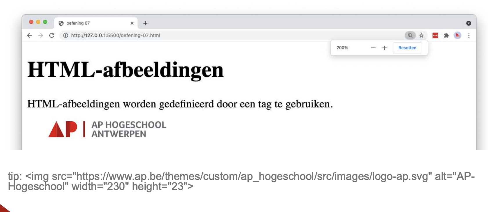

# image

## Opgave

* Maak een `index.html` met de basisstructuur van een HTML5-document en geef het document de titel `image`.
* Plaats in een `main`-element een hoofdtitel en een paragraaf.
* Voeg daaronder het logo van AP-Hogeschool toe met een `img`-element.
  * gebruik als `src` de URL `https://www.ap.be/themes/custom/ap_hogeschool/src/images/logo-ap.svg`
  * voorzie een zinvolle `alt`-tekst
  * geef de afbeelding een `width` van 230 en een `height` van 23

## Copy

- HTML-afbeeldingen
- HTML-afbeeldingen worden gedefinieerd door een tag te gebruiken.

## Verwacht resultaat

