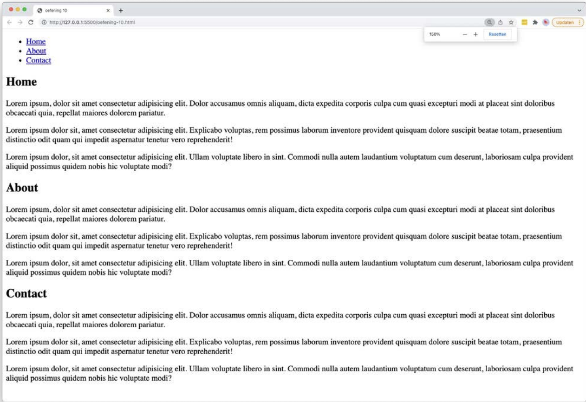

# link-internal

## Opgave

* Maak een `index.html` met de basisstructuur van een HTML5-document en geef het document de titel `link-internal`.
* Plaats bovenaan een `header` met daarin een `nav` en een lijst van drie links: Home, About en Contact.
* Zet in het `main`-element drie `section`-elementen onder elkaar. Elke sectie bevat een titel en drie paragrafen "lorem ipsum" dummytekst.
* Geef elke sectie een uniek `id` en laat de links uit de navigatie naar die id's verwijzen, zodat je met één klik naar de juiste sectie op **dezelfde** pagina springt.

> Tip: een interne verwijzing schrijf je als `<a href="#nav-item-1">`, waarbij `nav-item-1` het id van het doelelement is.

## Copy

- Home
- About
- Contact

## Verwacht resultaat

