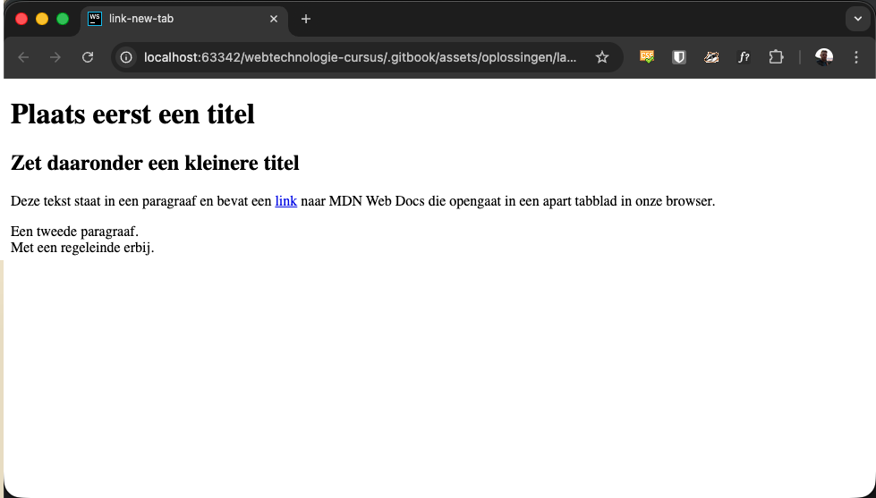

# link-new-page

## Opgave

* Maak een `index.html` met de basisstructuur van een HTML5-document en geef het document de titel `link-new-page`.
* Plaats in een `main`-element een hoofdtitel (`h1`) en daaronder een kleinere titel (`h2`).
* Schrijf een paragraaf waarin het woord "link" een verwijzing is naar [MDN Web Docs](https://developer.mozilla.org/en-US/). Zorg dat die link in een **apart tabblad** opent.
* Voeg een tweede paragraaf toe met daarin een regeleinde (`br`).

## Copy

- Plaats eerst een titel
- Zet daaronder een kleinere titel
- Deze tekst staat in een paragraaf en bevat een link naar MDN Web Docs die opengaat in een apart tabblad in onze browser.
- Een tweede paragraaf.
- Met een regeleinde erbij.

## Verwacht resultaat

