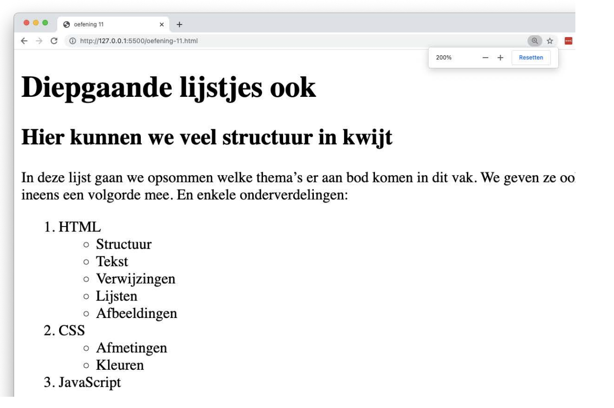

# list-nested

## Opgave

* Maak een `index.html` met de basisstructuur van een HTML5-document.
* Plaats in een `main`-element een hoofdtitel (`h1`), een ondertitel (`h2`) en een paragraaf.
* Maak daaronder een **geordende** lijst met de drie thema's van dit vak.
* Nestel bij HTML en bij CSS een **ongeordende** lijst met de onderdelen van dat thema. Let goed op waar je de geneste `ul` opent en sluit: die hoort **binnen** het `li`-element van het hoofdthema.

## Copy

- Diepgaande lijstjes ook
- Hier kunnen we veel structuur in kwijt
- In deze lijst gaan we opsommen welke thema's er aan bod komen in dit vak. We geven ze ook ineens een volgorde mee. En enkele onderverdelingen:
- HTML: Structuur, Tekst, Verwijzingen, Lijsten, Afbeeldingen
- CSS: Afmetingen, Kleuren
- JavaScript

## Verwacht resultaat

