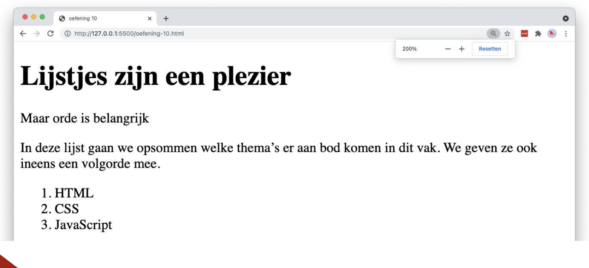

# list-number

## Opgave

* Maak een `index.html` met de basisstructuur van een HTML5-document.
* Plaats in een `main`-element een hoofdtitel en twee paragrafen.
* Som daaronder de drie thema's van dit vak op in een **geordende** lijst (`ol`), zodat de browser de nummering zelf toevoegt.

## Copy

- Lijstjes zijn een plezier
- Maar orde is belangrijk
- In deze lijst gaan we opsommen welke thema's er aan bod komen in dit vak. We geven ze ook ineens een volgorde mee.
- HTML
- CSS
- JavaScript

## Verwacht resultaat

