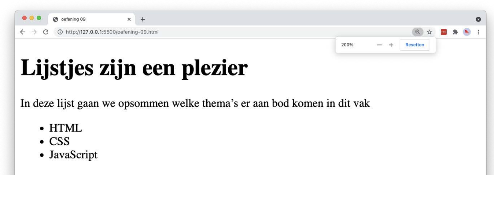

# lists-bullet

## Opgave

* Maak een `index.html` met de basisstructuur van een HTML5-document.
* Plaats in een `main`-element een hoofdtitel en een paragraaf.
* Som daaronder de drie thema's van dit vak op in een **ongeordende** lijst (`ul`), waarbij elk thema in een eigen `li`-element staat.

## Copy

- Lijstjes zijn een plezier
- In deze lijst gaan we opsommen welke thema's er aan bod komen in dit vak
- HTML
- CSS
- JavaScript

## Verwacht resultaat

