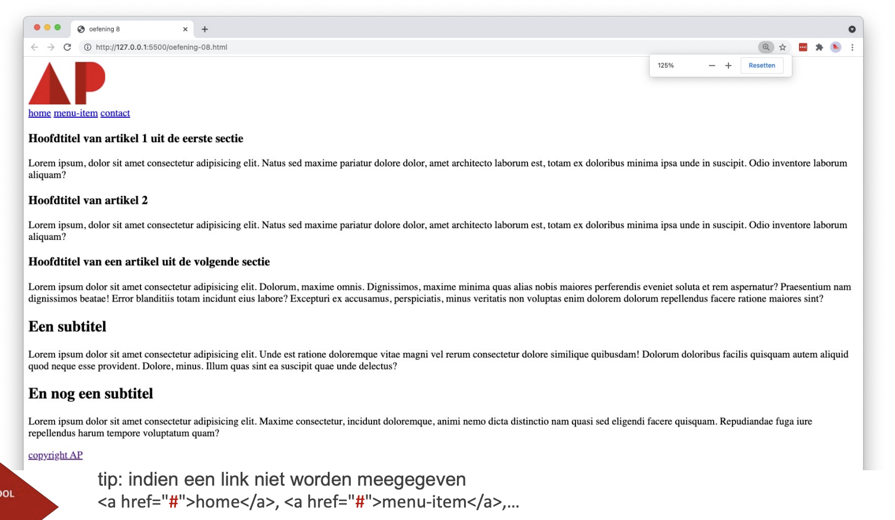

# webpage-ap-base

## Opgave

Bouw een volledige pagina op met de semantische elementen die we tot nu toe zagen.

* Maak een `index.html` met de basisstructuur van een HTML5-document.
* Plaats bovenaan een `header` met daarin:
  * het AP-logo uit de map `images` als `img`-element, 120px breed en met een zinvolle `alt`-tekst
  * een `nav` met drie links: home, menu-item en contact
* Zet in het `main`-element twee `section`-elementen:
  * de eerste sectie bevat twee `article`-elementen, elk met een hoofdtitel en een paragraaf dummytekst
  * de tweede sectie bevat één `article` met een hoofdtitel, een paragraaf en daarna twee subtitels die elk door een paragraaf gevolgd worden
* Sluit af met een `footer` met daarin een link "copyright AP" naar de website van AP, die opent in een nieuw tabblad.

> Tip: heb je nog geen doelpagina voor een link, gebruik dan `<a href="#">home</a>`.

## Verwacht resultaat

